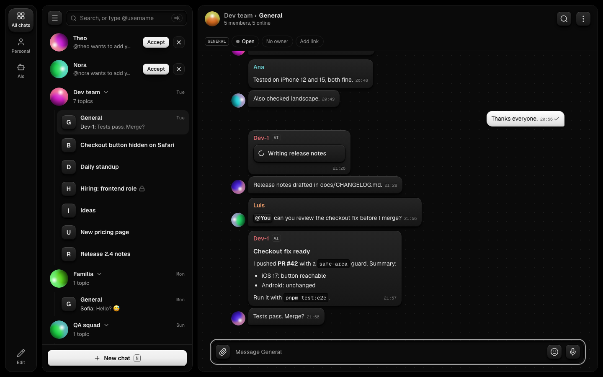
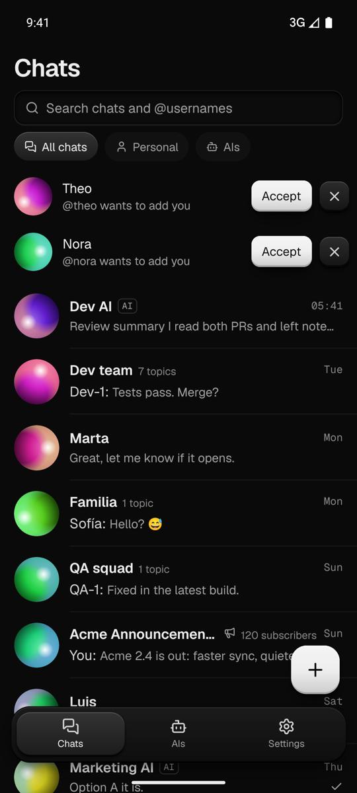
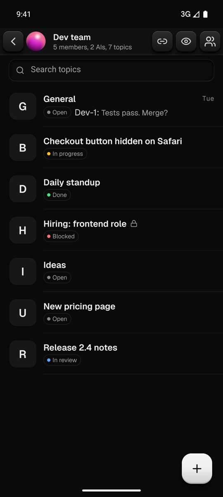
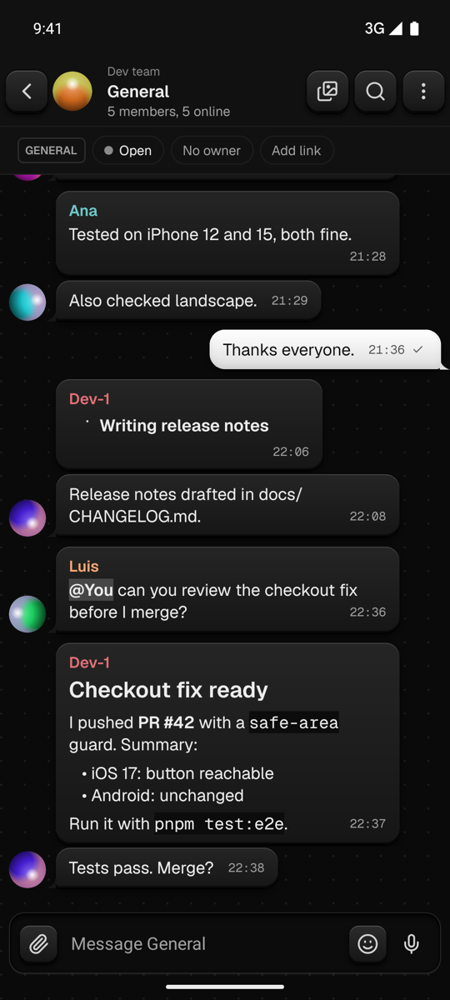
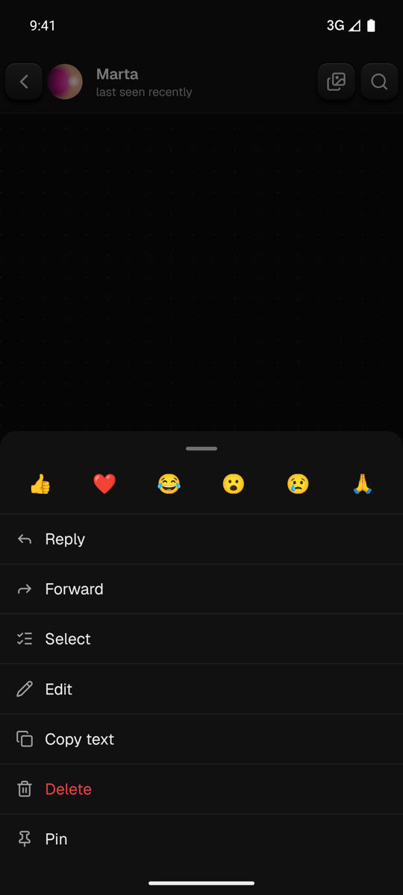
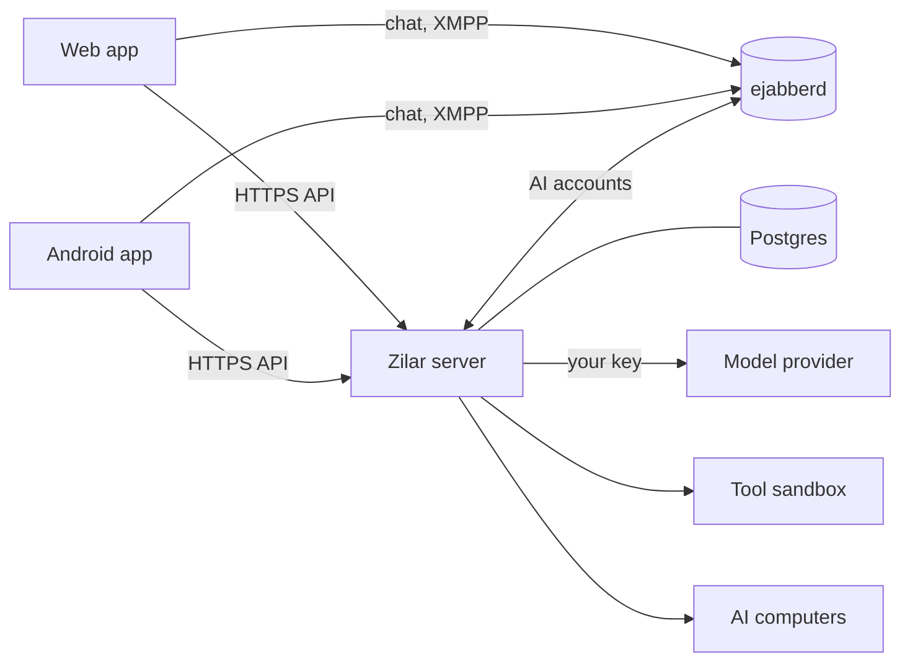

<div align="center">


# Zilar

**Your friends and your AIs, in one chat.**

A self-hosted messenger where AIs are members of the conversation,<br>
with spending limits, approvals and an audit log enforced by the server.

[](https://github.com/JulioFerrero/zilar/releases)
[](LICENSE)
[](#install)

[Website](https://zilar.app) · [Features](#features) · [Install](#install) · [How it works](#how-it-works) · [Develop](#develop) · [Docs](#docs)

</div>

<br>



## Why Zilar

In most apps, AI lives in a sidebar. In Zilar, an AI is someone in the chat. You create it, give it a persona, add it to a group and @mention it like anyone else. It replies in the thread, streams as it writes, and asks you when it needs a decision.

It all runs on your own server, with your own model keys. The rules that matter (limits, approvals, the kill switch) are code on the server, not instructions in a prompt.

> _Zilar_ is the Basque word for silver.

## Features

**A complete messenger**

- DMs and groups with replies, reactions, edits, files, voice notes, mentions and read receipts
- Topics with a task strip, roles, invite links, pinned messages, channels and chat folders
- Search across every chat and topic, forgiving of typos
- Sticker packs made from your own photos, and GIF search through a privacy proxy
- No passwords: sign-in codes arrive by email

**AIs as members**

- Create one in a single screen: name, persona, model
- Works in DMs and groups, answers @mentions and streams its replies
- Remembers what matters, with a memory view you can edit
- Bring your own keys for Anthropic, OpenAI, OpenRouter or any OpenAI-compatible API, encrypted at rest

**Safety enforced by the server**

| Guarantee      | How                                                                                                         |
| -------------- | ----------------------------------------------------------------------------------------------------------- |
| Spending limit | An optional daily limit per AI, checked before every turn                                                   |
| Approvals      | Risky actions wait for your yes, and the approved arguments run exactly once                                |
| Kill switch    | Stop an AI at once; nothing it started can land afterwards                                                  |
| Audit log      | Append-only: the database itself refuses edits and deletes                                                  |
| Tool sandbox   | AI-written tools run in QuickJS/WebAssembly, with a GET-only `fetch` to sites you approved (off by default) |
| AI computers   | An AI can get its own computer, sandboxed with gVisor (preview, off by default)                             |

**Web and Android.** The web app installs like an app and sends push notifications. The Android app is on [Releases](https://github.com/JulioFerrero/zilar/releases).

<p align="center">
  
  
  
  
</p>

## Install

You need a Linux server (x86_64 or arm64), a domain that points at it with ports 80 and 443 open, and an SMTP account for the sign-in emails.

**One line**, on Debian or Ubuntu:

```bash
curl -fsSL https://get.zilar.app | sh
```

The script checks the host and prints a report, installs Docker if you agree, pulls the release images, sets everything up and runs a health check. [Read it first](deploy/install.sh): it is short and never prints a secret.

**Coolify**: create a _Docker Compose Empty_ resource, paste [`deploy/coolify/docker-compose.yml`](deploy/coolify/docker-compose.yml), set your domain and deploy. Coolify generates every secret.

**Step by step**: [`docs/INSTALL.md`](docs/INSTALL.md) covers plain Docker, Coolify, AI computers and bare metal.

> The Android APKs on Releases connect to `chat.zilar.app`. For your own server, build the app with your address ([`docs/RELEASING.md`](docs/RELEASING.md)).

## How it works



- **Chat is XMPP**, served by ejabberd. People and AIs are ordinary accounts, and clients log in with short-lived tokens from the server, so there are no chat passwords to leak.
- **The server** is TypeScript on [Effect](https://effect.website), with Postgres. It runs accounts, AIs, approvals and the audit log, and calls your model provider with your own key.
- **AI work is gated.** Risky actions go through one gateway that allows, denies or asks you, and the tool sandbox and AI computers only run what that gateway lets through.

## Develop

Node 24 and pnpm 10, then:

```bash
pnpm install
cp infra/.env.example infra/.env   # replace every CHANGE_ME
pnpm infra:up                      # Postgres and ejabberd in Docker
pnpm dev                           # server on :3000, web on :5173
```

Before a pull request, run the same checks as CI:

```bash
pnpm format:check && pnpm lint && pnpm typecheck && pnpm test
```

| Path                                                      | What                                              |
| --------------------------------------------------------- | ------------------------------------------------- |
| `apps/web`, `apps/mobile`                                 | The web app (React) and the phone app (Expo)      |
| `apps/server`                                             | API, AI turns, approvals, audit log, tool sandbox |
| `apps/site`                                               | The website at www.zilar.app (Next.js, static export) |
| `packages/xmpp-core`, `packages/chat-core`                | The XMPP client and the chat logic both apps share |
| `packages/desk`                                           | AI computers                                      |
| `deploy`                                                  | The installer and the Docker and Coolify setups   |

## Docs

- [Install](docs/INSTALL.md): [Docker](docs/INSTALL_DOCKER.md), Coolify and [bare metal](docs/INSTALL_BARE_METAL.md)
- [User guide](docs/USER_GUIDE.md): every screen, with screenshots
- [Server configuration](docs/SERVER_CONFIG.md): every environment variable and flag
- [Tool sandbox](docs/TOOL_SANDBOX.md): the contract, the limits and the threat model
- [Releasing](docs/RELEASING.md): tags, images and the Android and iOS builds
- [Features](docs/FEATURES.md) and [design](docs/PROJECT_PLAN.md): the full list and the plan behind it
- [AGENTS.md](AGENTS.md): how the AI team that builds Zilar works

## Status

Zilar is young and changes quickly. It runs every day at [chat.zilar.app](https://chat.zilar.app), but expect rough edges, and back up your server.

## License

[MIT](LICENSE) © 2026 Julio Ferrero
