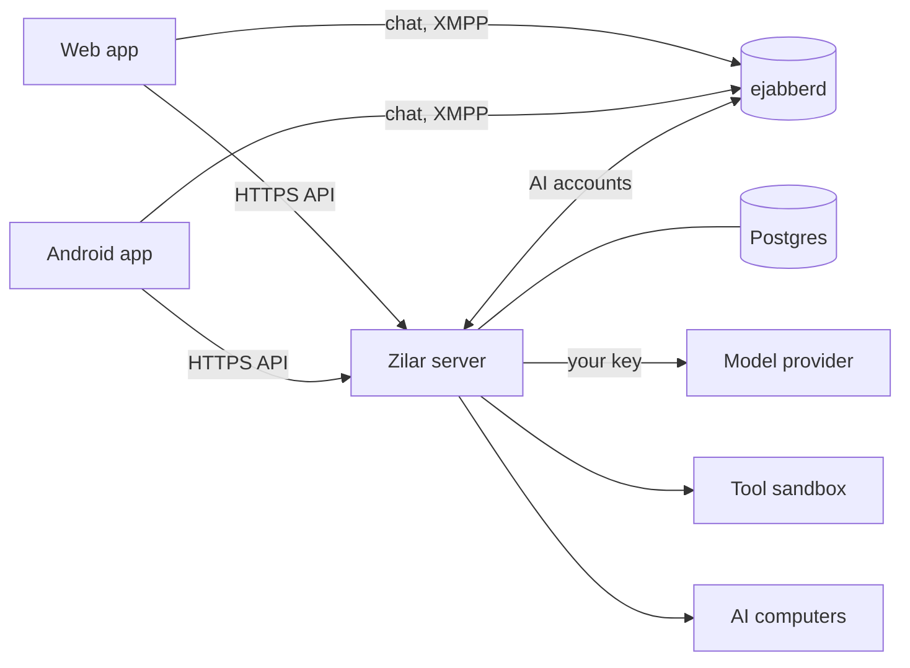

# T-1597: New README

## Spec (written by Claude, do not edit)

### Why
- **Julio asked for it** (2026-10-15): the README should be "cooler and simpler and professional".
- **The current `README.md` (250 lines) is out of date.** It names Hono, Drizzle, LiteLLM and zod (none of which the code uses today: `git grep` finds 0 hits in `apps/*/src` and `packages/*/src`). It also lists milestones from September and the old raw-GitHub install line.

### Facts (the lead checked them on 2026-10-15, main `38c7c5695`)
- **Server dependencies** (`apps/server/package.json`): `effect`, `@effect/sql-pg`, `@effect/ai-anthropic`, `@effect/ai-openai`, `@effect/ai-openai-compat`, `@effect/ai-openrouter`, `better-auth`, `quickjs-emscripten`, `@xmpp/client`, `@xmpp/component`, `web-push`.
- **Spending limits:** a daily limit per AI, checked before each turn (`apps/server/src/agents/gateway/budget.ts:190`, `apps/server/src/agents/dm-turn.ts:24`).
- **Images:** `ghcr.io/julioferrero/zilar-server:v0.2.0` is `linux/amd64` + `linux/arm64`. `https://get.zilar.app` serves `deploy/install.sh`.
- **The phone app's server URL is fixed at build time** (`apps/mobile/src/lib/auth.ts:14`, `EXPO_PUBLIC_ZILAR_API_URL`); the release APKs use `https://chat.zilar.app`.
- **Paths the text uses, all present:**
  - `assets/brand/icon.png`;
  - `docs/screenshots/topic-desktop.png`, `android-chats.png`, `android-topics.png`, `android-topic.png`, `android-message-menu.png`;
  - `deploy/install.sh`, `deploy/coolify/docker-compose.yml`, `LICENSE` (MIT);
  - `docs/INSTALL.md`, `docs/INSTALL_DOCKER.md`, `docs/INSTALL_BARE_METAL.md`, `docs/RELEASING.md`, `docs/SERVER_CONFIG.md`, `docs/TOOL_SANDBOX.md`, `docs/USER_GUIDE.md`, `docs/FEATURES.md`, `docs/PROJECT_PLAN.md`, `AGENTS.md`.
- **Tooling:** `.nvmrc` is `24`; `packageManager` is `pnpm@10.32.1`. Root scripts: `dev`, `infra:up`, `infra:down`, `format:check`, `lint`, `typecheck`, `test`, `build`, `gate`. The `infra/.env.example` file exists.

### Steps
1. **Replace the whole of `README.md`** with the text between the `~~~~` lines below, word for word. The `~~~~` lines themselves are not part of it.
2. **Run `pnpm exec prettier --write README.md`.** Prettier may re-wrap or re-align; do not change any words.
3. **Check every relative link and image** in the new `README.md` exists in the repo (a small `grep -o` plus `test -e` loop is fine, run it, don't commit it). List the result in the Report.
4. **If a sentence states something you find false in the code, do not change it.** Say which sentence and why in the Report.

~~~~
<div align="center">


# Zilar

**Your friends and your AIs, in one chat.**

A self-hosted messenger where AIs are members of the conversation,<br>
with spending limits, approvals and an audit log enforced by the server.

[](https://github.com/JulioFerrero/zilar/releases)
[](LICENSE)
[](#install)

[Website](https://zilar.app) · [Features](#features) · [Install](#install) · [How it works](#how-it-works) · [Develop](#develop) · [Docs](#docs)

</div>

<br>


## Why Zilar

In most apps, AI lives in a sidebar. In Zilar, an AI is someone in the chat. You create it, give it a persona, add it to a group and @mention it like anyone else. It replies in the thread, streams as it writes, and asks you when it needs a decision.

It all runs on your own server, with your own model keys. The rules that matter (limits, approvals, the kill switch) are code on the server, not instructions in a prompt.

> _Zilar_ is the Basque word for silver.

## Features

**A complete messenger**

- DMs and groups with replies, reactions, edits, files, voice notes, mentions and read receipts
- Topics with a task strip, roles, invite links, pinned messages, channels and chat folders
- Search across every chat and topic, forgiving of typos
- Sticker packs made from your own photos, and GIF search through a privacy proxy
- No passwords: sign-in codes arrive by email

**AIs as members**

- Create one in a single screen: name, persona, model
- Works in DMs and groups, answers @mentions and streams its replies
- Remembers what matters, with a memory view you can edit
- Bring your own keys for Anthropic, OpenAI, OpenRouter or any OpenAI-compatible API, encrypted at rest

**Safety enforced by the server**

| Guarantee      | How                                                                                                         |
| -------------- | ----------------------------------------------------------------------------------------------------------- |
| Spending limit | An optional daily limit per AI, checked before every turn                                                   |
| Approvals      | Risky actions wait for your yes, and the approved arguments run exactly once                                |
| Kill switch    | Stop an AI at once; nothing it started can land afterwards                                                  |
| Audit log      | Append-only: the database itself refuses edits and deletes                                                  |
| Tool sandbox   | AI-written tools run in QuickJS/WebAssembly, with a GET-only `fetch` to sites you approved (off by default) |
| AI computers   | An AI can get its own computer, sandboxed with gVisor (preview, off by default)                             |

**Web and Android.** The web app installs like an app and sends push notifications. The Android app is on [Releases](https://github.com/JulioFerrero/zilar/releases).

<p align="center">
  
  
  
  
</p>

## Install

You need a Linux server (x86_64 or arm64), a domain that points at it with ports 80 and 443 open, and an SMTP account for the sign-in emails.

**One line**, on Debian or Ubuntu:

```bash
curl -fsSL https://get.zilar.app | sh
```

The script checks the host and prints a report, installs Docker if you agree, pulls the release images, sets everything up and runs a health check. [Read it first](deploy/install.sh): it is short and never prints a secret.

**Coolify**: create a _Docker Compose Empty_ resource, paste [`deploy/coolify/docker-compose.yml`](deploy/coolify/docker-compose.yml), set your domain and deploy. Coolify generates every secret.

**Step by step**: [`docs/INSTALL.md`](docs/INSTALL.md) covers plain Docker, Coolify, AI computers and bare metal.

> The Android APKs on Releases connect to `chat.zilar.app`. For your own server, build the app with your address ([`docs/RELEASING.md`](docs/RELEASING.md)).

## How it works



- **Chat is XMPP**, served by ejabberd. People and AIs are ordinary accounts, and clients log in with short-lived tokens from the server, so there are no chat passwords to leak.
- **The server** is TypeScript on [Effect](https://effect.website), with Postgres. It runs accounts, AIs, approvals and the audit log, and calls your model provider with your own key.
- **AI work is gated.** Risky actions go through one gateway that allows, denies or asks you, and the tool sandbox and AI computers only run what that gateway lets through.

## Develop

Node 24 and pnpm 10, then:

```bash
pnpm install
cp infra/.env.example infra/.env   # replace every CHANGE_ME
pnpm infra:up                      # Postgres and ejabberd in Docker
pnpm dev                           # server on :3000, web on :5173
```

Before a pull request, run the same checks as CI:

```bash
pnpm format:check && pnpm lint && pnpm typecheck && pnpm test
```

| Path                                                      | What                                              |
| --------------------------------------------------------- | ------------------------------------------------- |
| `apps/web`, `apps/mobile`                                 | The web app (React) and the phone app (Expo)      |
| `apps/server`                                             | API, AI turns, approvals, audit log, tool sandbox |
| `apps/site`                                               | The website at zilar.app                          |
| `packages/xmpp-core`, `packages/chat-core`                | The XMPP client and the chat logic both apps share |
| `packages/desk`                                           | AI computers                                      |
| `deploy`                                                  | The installer and the Docker and Coolify setups   |

## Docs

- [Install](docs/INSTALL.md): [Docker](docs/INSTALL_DOCKER.md), Coolify and [bare metal](docs/INSTALL_BARE_METAL.md)
- [User guide](docs/USER_GUIDE.md): every screen, with screenshots
- [Server configuration](docs/SERVER_CONFIG.md): every environment variable and flag
- [Tool sandbox](docs/TOOL_SANDBOX.md): the contract, the limits and the threat model
- [Releasing](docs/RELEASING.md): tags, images and the Android and iOS builds
- [Features](docs/FEATURES.md) and [design](docs/PROJECT_PLAN.md): the full list and the plan behind it
- [AGENTS.md](AGENTS.md): how the AI team that builds Zilar works

## Status

Zilar is young and changes quickly. It runs every day at [chat.zilar.app](https://chat.zilar.app), but expect rough edges, and back up your server.

## License

[MIT](LICENSE) © 2026 Julio Ferrero
~~~~

### Tests
None.

### Allowed files
- `README.md`
- `work/T-1597-readme-rewrite.md`

### Checks
```bash
pnpm gate
```

### Acceptance
- **`README.md` is exactly the text above,** except where prettier changed whitespace or alignment.
- **The Report lists** every relative path the README links to, each marked as present.

---

## Report (written by the worker when done)

### What I did

- Read `AGENTS.md` and this task file completely first.
- Ran `pnpm install` (done in 18s, pnpm v10.32.1).
- Set `status: in-progress`.
- Replaced the whole of `README.md` with the lead's text word for word (extracted the exact block between the `~~~~` fences, task lines 40–187; no words, punctuation or emoji changed). The old 250-line README is gone; the new `README.md` is 148 lines.
- Ran `pnpm exec prettier --write README.md`: it reported no changes (the text was already Prettier-formatted), so nothing was re-wrapped or re-aligned. Verified with `pnpm exec prettier --check README.md` → exit 0.
- Checked every relative link and image path with a `grep -o` + `test -e` loop (see below). All present.
- Spot-checked the text's claims against the code (step 4). Found no false sentence; see notes.

### Checks run

`pnpm exec prettier --check README.md` → exit 0, "All matched files use Prettier code style!"

Relative paths in the new `README.md`, all checked present with `test -e` (19/19 present, 0 missing):

- `LICENSE` — present
- `AGENTS.md` — present
- `assets/brand/icon.png` — present
- `docs/FEATURES.md` — present
- `docs/INSTALL.md` — present
- `docs/INSTALL_BARE_METAL.md` — present
- `docs/INSTALL_DOCKER.md` — present
- `docs/PROJECT_PLAN.md` — present
- `docs/RELEASING.md` — present
- `docs/SERVER_CONFIG.md` — present
- `docs/TOOL_SANDBOX.md` — present
- `docs/USER_GUIDE.md` — present
- `docs/screenshots/android-chats.png` — present
- `docs/screenshots/android-message-menu.png` — present
- `docs/screenshots/android-topic.png` — present
- `docs/screenshots/android-topics.png` — present
- `docs/screenshots/topic-desktop.png` — present
- `deploy/install.sh` — present
- `deploy/coolify/docker-compose.yml` — present

Anchors (`#install`, `#features`, `#how-it-works`, `#develop`, `#docs`) and the absolute `https://…` links were excluded from the file check (they are anchors/external URLs, not repo paths). No relative path is missing.

`pnpm gate` (from repo root) summary lines:

```
gate: 2 changed file(s) against main
PASS  install (frozen)  (4.1s)
PASS  format  (1.3s)
PASS  lint  (1.3s)
PASS  typecheck  (2.2s)
SKIP effect (no source files changed)
scope: every changed file is inside the Allowed files
migration: every added migration continues from the base
images: every workspace package an app image needs is copied into its Dockerfile
size: every changed source file is within 400 lines
GATE PASS
```

The 2 changed files are `README.md` and `work/T-1597-readme-rewrite.md` — both inside Allowed files. No tests were run individually (README-only change; gate reported effect tests skipped).

### Notes for the lead

- **Step 4 (false sentences):** I did not change any sentence. Spot checks found nothing false:
  - Server deps named in the text: verified `effect`, `@effect/sql-pg`, `@effect/ai-{anthropic,openai,openai-compat,openrouter}`, `better-auth`, `quickjs-emscripten`, `web-push` are in `apps/server/package.json`.
  - "Append-only: the database itself refuses edits and deletes": verified by `apps/server/drizzle/0013_audit_log_immutable.sql` (trigger blocking UPDATE/DELETE).
  - "An optional daily limit per AI, checked before every turn": verified in `apps/server/src/agents/gateway/budget.ts` ("daily spending limit reached; turn skipped").
- **Deviations:** none. The README is exactly the lead's text except for a trailing newline added by writing the file.
- **Open questions:** none.

### Blocked / needs a decision

None.

## Review (written by Claude)

**Approved and merged.**

- **Pre-review:** clean, 0 nits.
- **What the lead checked on the branch:**
  - `diff -w` of `README.md` against the spec text is empty, at 148 lines (250 before);
  - all 19 relative links and image paths exist;
  - the worker's step-4 checks found no false sentence.
- **The rendered page on GitHub** is checked after merge (headless screenshot of the repo page).
